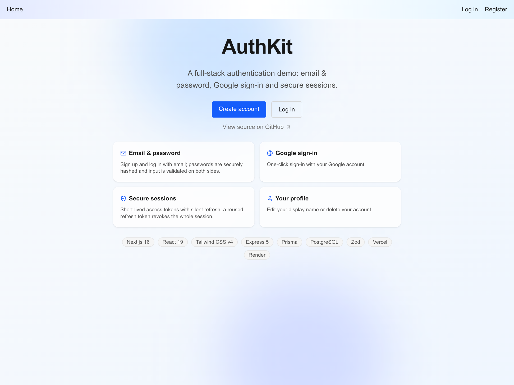
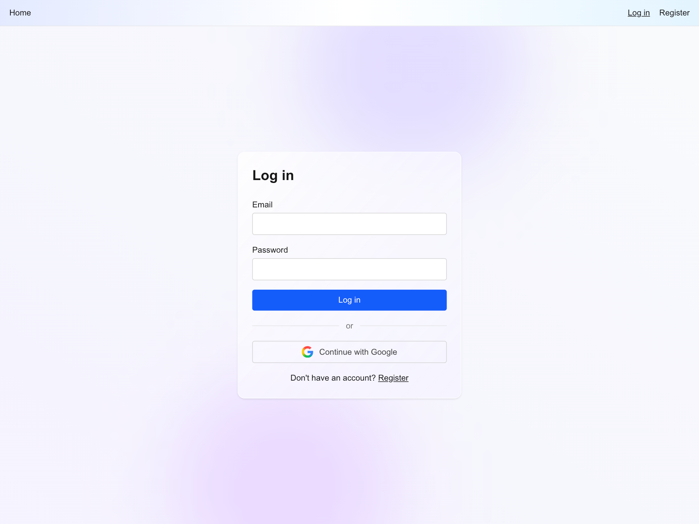
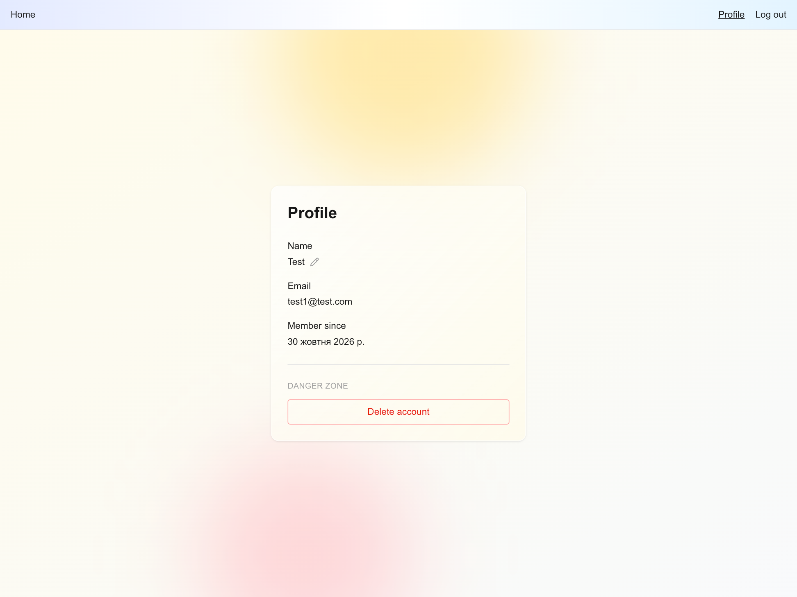

# authkit-next-express

[](https://github.com/Oleksandr-Perekhrest/authkit-next-express/actions/workflows/ci.yml)
[](LICENSE)

A full-stack authentication system demonstrating email/password and Google OAuth flows with JWT access tokens and rotating refresh tokens in httpOnly cookies — built as a pnpm monorepo with Next.js 16 on Vercel and Express 5 on Render.

## Live demo

<https://authkit-web.vercel.app>

The API runs on Render's free plan and sleeps after 15 minutes of inactivity. The first request after a cold start can take up to a minute — the UI shows a notice while the API wakes up.

## Screenshots

| Home                                    | Sign in                                     | Profile                                       |
| --------------------------------------- | ------------------------------------------- | --------------------------------------------- |
|  |  |  |

## Architecture


Every API call from the browser targets the Vercel domain under `/api/*`. Next.js rewrites those requests to the Render service so cookies are set on the Vercel origin and remain first-party — `SameSite=Lax` does not block them and no CORS configuration is needed. The Google OAuth redirect URI also lands on the Vercel domain, keeping the callback in the same origin as the rest of the app.

## Tech stack

| Technology                            | Role              | Why                                                                                |
| ------------------------------------- | ----------------- | ---------------------------------------------------------------------------------- |
| **Next.js 16** (App Router, React 19) | Frontend          | Server components by default; rewrite-based API proxy keeps cookies first-party    |
| **Tailwind CSS v4**                   | Styles            | Utility-first, zero runtime, co-located with components                            |
| **Express 5**                         | API               | Minimal and well-understood; async errors propagate to middleware by default       |
| **tsdown**                            | API bundler       | Bundles to a single ESM file with `@authkit/shared` inlined; no extra install step |
| **Prisma**                            | ORM + migrations  | Type-safe queries, schema-driven migrations, first-class Postgres support          |
| **jose**                              | JWT               | Web-standard crypto API, no native bindings; HS256 sign and verify                 |
| **argon2**                            | Password hashing  | argon2id is memory-hard and has no 72-byte input limit like bcrypt                 |
| **Zod + `@authkit/shared`**           | Schema validation | Single source of truth for request shapes and inferred types shared across apps    |
| **arctic**                            | OAuth 2.0 client  | Handles PKCE, token exchange, and ID token decoding for Google                     |
| **express-rate-limit**                | Rate limiting     | Simple per-IP limits without an external store                                     |

## Security design

### Password policy

- Minimum length is **8 characters** (OWASP). NIST SP 800-63B-4 recommends 15 when a password is the only factor; 8 was chosen to keep sign-up friction low in a demo.
- Maximum length is **128 characters**, so passphrases and password-manager output fit without asking the server to hash arbitrarily long input.
- No composition rules (uppercase, digits, symbols): they push users toward predictable patterns like `Password1!` without adding real strength.
- Login only checks that the password is non-empty, so a future policy change never locks out existing users.

### Password hashing

Passwords are hashed with **argon2id** (`argon2` package). A dummy hash is computed once at module load. When the email is not found, the password is still checked with `argon2.verify` against that dummy hash, so an unknown email takes the same time as a wrong password for an existing account. Both cases return `401 INVALID_CREDENTIALS`.

### Tokens

- **Access token**: JWT (HS256, `jose`), expires in **15 minutes**. The payload contains only `sub` (user id), `iat`, and `exp` — no personal data, since JWTs are signed but not encrypted.
- **Refresh token**: `randomBytes(32).toString("base64url")` — 32 bytes of entropy as a base64url string, valid for **30 days**. Only its SHA-256 hex digest is stored in the database, so a leaked table cannot be replayed to create sessions. A fast hash is appropriate here because the token is cryptographically random, unlike a password.

### Refresh rotation and reuse detection

Every successful `/auth/refresh` call atomically revokes the presented token and issues a fresh one under the same `familyId` (a UUID assigned at login). This is the most nuanced part of the security model:

- **Concurrent tabs**: two tabs may race to refresh the same token before either has received its replacement. A 10-second grace window handles this: if a just-rotated token is presented again within 10 seconds while the family still has an active token, the server returns **409 REFRESH_CONFLICT** and the client retries with whichever token it holds. The race inside the rotation transaction is resolved with an optimistic lock (`updateMany` count check), which also returns 409 on collision.
- **Token theft**: if a revoked token is presented after the grace window while the family still has active tokens, the server revokes the entire family and returns 401. Both the legitimate user and a potential attacker are forced to log in again.
- **Logout** deletes every token in the presenting token's family (current device only). **Logout-all** deletes every token across all families for the user (all devices).

### Google OAuth

Authorization Code + PKCE via `arctic`. The `state` and `code_verifier` values are stored in short-lived HttpOnly cookies and validated before the token exchange. After the exchange:

- `email_verified` must be `true` — unverified Google accounts are rejected.
- `aud` is checked against `GOOGLE_CLIENT_ID` and `iss` against `accounts.google.com` / `https://accounts.google.com`.
- Lookup is by Google `sub` (stable account ID), not by email. If a `sub` match is found, the user signs in. If only an email match exists (an account registered with a password), the callback redirects to `/login?toast=account_exists` — no automatic account linking, which prevents account pre-hijacking.
- `emailVerified` is set to the current time on every Google sign-in for accounts where it was previously `null`.

### Cookie flags

Both auth cookies carry `HttpOnly`, `SameSite=Lax`, `Path=/`, and `Secure` in production (`NODE_ENV === "production"`). `Secure` is omitted in development so `http://localhost` works without HTTPS. `Path=/` serves two purposes: the API operates at `/auth/*` but the browser accesses those routes at `/api/auth/*`, so a narrower path would not match from the browser's perspective; and the Next.js middleware in `apps/web/src/proxy.ts` reads `refresh_token` on the `/profile` route, which is outside `/api`.

### Rate limiting

`express-rate-limit`, per IP, in-memory — counters reset on process restart, which is fine for a single instance.

| Endpoint              | Limit | Window     | Notes                           |
| --------------------- | ----- | ---------- | ------------------------------- |
| `POST /auth/login`    | 10    | 15 minutes | Successful requests not counted |
| `POST /auth/register` | 5     | 1 hour     | All requests counted            |

Limiters run before request validation, so malformed requests count toward the limit.

## Tests

### Unit tests

| Package           | Tests |
| ----------------- | ----- |
| `apps/api`        | 14    |
| `apps/web`        | 38    |
| `packages/shared` | 22    |

Run with `pnpm test`.

### Integration tests

24 tests across 9 files in `apps/api/test/integration/`, run with `pnpm test:integration`.

- **Real stack**: each test file calls `createApp()` and passes the Express instance to Supertest, which binds it in-process — no network port is opened. Requests reach a real Postgres instance.
- **Isolated database**: a safety guard in both `globalSetup` and the DB helper rejects any `DATABASE_URL` that does not target the `authkit_test` database, preventing accidental writes to dev or prod data.
- **Sequential files**: `fileParallelism: false` — no inter-file interference.
- **Clean state**: each test file calls `truncateAll()` in `beforeEach` to reset all tables before every test.
- The `authkit_test` database is created and migrated automatically on first run and kept between runs.

### CI

The `checks` job runs format, lint, typecheck, unit tests, integration tests, and build on every PR and push to `main`. The `docker` job builds the production image and runs a smoke test against an empty database — migrations are applied from scratch inside the container, and the job polls `GET /health` for up to 60 seconds.

## Engineering workflow

- **GitHub Flow**: every change goes through a PR; three required checks must pass — `checks` (format, lint, typecheck, tests, build), `docker` (image build + smoke test), and `PR title` (Conventional Commits format).
- **Conventional Commits**: PR titles follow the spec and become the squash-merge commit message.
- **Lefthook hooks**: pre-commit runs `eslint --fix` and `prettier --write` on staged files and re-stages the fixed files; pre-push mirrors the full CI suite locally before the push lands.
- **Squash merges**: one clean commit per PR on `main`.
- **Tagged releases**: `v0.1.0` – `v0.9.0`, one per development stage.

## How it was built

The system was developed in nine stages from a working roadmap, each closed as a tagged release (`v0.1.0`–`v0.9.0`) with a written decision record: monorepo setup → database and API structure → registration and login → refresh rotation and logout → web frontend → Google OAuth → deployment → post-deploy hardening → tests. Implementation was done with Claude Code, with every change reviewed before merging.

## Known limitations

- **In-memory rate limiting**: counters live in process memory and reset on restart; adequate for a single instance but not horizontally scalable.
- **No email verification for password accounts**: `emailVerified` is set only on Google sign-in; accounts registered with email/password have it `null`.
- **Render free-plan cold starts**: the API sleeps after 15 minutes of inactivity; the first request can take up to a minute.
- **No session management UI**: sessions are not listed or labelled by device, so a user cannot revoke a single other device. Logout-all signs out everywhere, including the current session.
-

## Local development

**Prerequisites:** Node.js 24 (`.nvmrc`), pnpm via corepack, Docker.

<details>
<summary>Full setup steps</summary>

```bash
nvm use
corepack enable pnpm
pnpm install          # installs deps and git hooks (lefthook)

# start the local database
pnpm db:up

# copy and fill env files
cp apps/api/.env.example apps/api/.env
cp apps/web/.env.example apps/web/.env.local
# fill in JWT_ACCESS_SECRET and Google credentials in apps/api/.env

# run migrations
pnpm --filter @authkit/api db:migrate

# start both apps
pnpm dev
```

- Web: <http://localhost:3000>
- API: <http://localhost:4000/health>

</details>

| Script                  | Description                            |
| ----------------------- | -------------------------------------- |
| `pnpm dev`              | Run web and API in watch mode          |
| `pnpm test`             | Vitest unit tests                      |
| `pnpm test:integration` | Integration tests (requires Docker DB) |
| `pnpm build`            | Build all packages                     |
| `pnpm lint`             | ESLint across the repo                 |
| `pnpm typecheck`        | `tsc` across all packages              |
| `pnpm format`           | Prettier write                         |
| `pnpm format:check`     | Prettier check without writing         |
| `pnpm db:up / db:down`  | Start / stop local Postgres via Docker |

`apps/api/http/auth.http` and `apps/api/http/users.http` are request scripts for the [JetBrains HTTP Client](https://www.jetbrains.com/help/idea/http-client-in-product-code-editor.html) and VS Code REST Client. They cover every API endpoint and are updated alongside route changes.

## Deployment

### Render

Deploy the API as a **Docker** service with these settings:

- **Dockerfile path:** `apps/api/Dockerfile`
- **Build context:** repo root (the Dockerfile copies workspace manifests from there)
- **Health check path:** `/health`
- **Build filters:** `apps/api/**`, `packages/shared/**`, `pnpm-lock.yaml`, `package.json`, `pnpm-workspace.yaml`, `tsconfig.base.json`, `.dockerignore` — changes outside these paths do not redeploy the API.

Migrations run automatically on container start. A failed migration exits the container; Render keeps the previous deploy running until the new one passes the health check.

`NODE_ENV=production` is set in the Dockerfile; `PORT` is provided by Render automatically.

| Variable               | Description                                                                             |
| ---------------------- | --------------------------------------------------------------------------------------- |
| `DATABASE_URL`         | Direct connection string from Prisma Postgres (pooling off), with `sslmode=verify-full` |
| `JWT_ACCESS_SECRET`    | HS256 signing secret, min 32 chars — generate with `openssl rand -base64 48`            |
| `GOOGLE_CLIENT_ID`     | Google OAuth client ID                                                                  |
| `GOOGLE_CLIENT_SECRET` | Google OAuth client secret                                                              |
| `GOOGLE_REDIRECT_URI`  | Must match the OAuth console: `https://<vercel-domain>/api/auth/google/callback`        |
| `TRUST_PROXY`          | Set to `4` — Vercel → Cloudflare → Render load balancer → local proxy (4 hops)          |

### Vercel

Set the **root directory** to `apps/web`. No build command override is needed.

| Variable  | Description                                                 |
| --------- | ----------------------------------------------------------- |
| `API_URL` | Render service URL, e.g. `https://authkit-api.onrender.com` |

### Run the production image locally

Use this to verify the image before merging changes to the Dockerfile or dependencies.

```bash
cp apps/api/.env.docker.example apps/api/.env.docker
# fill in JWT_ACCESS_SECRET and copy Google credentials from apps/api/.env
```

Build the image with the same Dockerfile and context used by CI and Render:

```bash
docker build -f apps/api/Dockerfile -t authkit-api:local .
```

Run it:

```bash
docker run --rm \
  --env-file apps/api/.env.docker \
  -p 4000:4000 \
  --add-host=host.docker.internal:host-gateway \
  authkit-api:local
```

`--add-host` maps `host.docker.internal` to the host on Linux; Docker Desktop resolves it automatically on macOS and Windows.

Verify with `curl localhost:4000/health` → HTTP 200.

## Project structure

```
apps/
  api/
    Dockerfile               production image (build context: repo root)
    http/                    JetBrains / VS Code HTTP request scripts
      auth.http
      users.http
    src/
      config/env.ts          Zod-validated environment
      db/                    Prisma client singleton
      jobs/                  background cleanup (expired refresh tokens)
      lib/                   tokens, password hashing, Google OAuth client
      middleware/            error handler, rate limiter, requireAuth, validate
      modules/
        auth/                routes → controller → service (all auth flows)
        health/              GET /health
        users/               GET /users/me, PATCH /users/me
    test/
      helpers/               Supertest agent helpers, DB truncation, global setup
      integration/           per-endpoint integration test files
  web/                       Next.js 16 App Router frontend
packages/
  shared/                    Zod schemas and inferred types consumed by both apps
```

## License

MIT — see [LICENSE](LICENSE).
