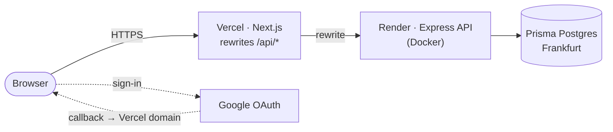

# authkit-next-express

A learning pet project implementing a full authentication cycle: email/password
sign-up and login, Google OAuth, and JWT access tokens paired with rotating
refresh tokens stored in httpOnly cookies. The frontend is Next.js 16 (App
Router) and the backend is Express 5, wired together in a pnpm monorepo.

## Live demo

<https://authkit-web.vercel.app>

The API runs on Render's free plan and sleeps after 15 minutes of inactivity.
The first request after a cold start can take up to a minute.

## Architecture



All API calls from the browser target the Vercel domain under `/api/*`. Next.js
rewrites those requests to the Render service so cookies are set on the Vercel
origin and remain first-party — no cross-site restrictions apply. Google OAuth
redirects also land on the Vercel domain, which keeps the callback in the same
origin as the rest of the app.

## Tech stack

- **Next.js 16** (App Router, React 19, Tailwind CSS v4) — frontend
- **Express 5** (bundled to ESM with tsdown) — API
- **Prisma** — ORM, migrations, Postgres driver
- **jose** — JWT signing and verification
- **argon2** — password hashing (argon2id)
- **Zod** — schema validation, shared between apps via `@authkit/shared`

## Security decisions

Deliberate choices, with the reasoning behind them.

### Password policy

- Minimum length is **8 characters** (OWASP). NIST SP 800-63B-4 asks for 15
  when a password is the only factor; 8 was chosen on purpose to keep sign-up
  friction low in a demo project.
- Maximum length is 128, so passphrases and password-manager output fit, but
  the server is never asked to hash arbitrarily long input.
- No composition rules (uppercase, digits, symbols): they push users toward
  predictable patterns like `Password1!` without adding real strength.
- Login only checks that the password is non-empty, so a future policy change
  never locks out existing users.

### Password hashing

- Passwords are hashed with **argon2id** (`argon2` package, default
  parameters). It is memory-hard, which makes GPU brute force expensive, and
  has no 72-byte input limit like bcrypt.
- Salt and parameters are stored inside the hash string itself.

### Tokens and sessions

- **Access token**: JWT (HS256, `jose`), lives **15 minutes**. Payload holds
  only `sub` (user id), `iat` and `exp`: a JWT is signed, not encrypted, so no
  personal data goes in it.
- **Refresh token**: an opaque random string (32 bytes), lives **30 days**.
  It is looked up in the database on every refresh anyway, so a JWT would add
  nothing but a second secret. Only its SHA-256 hash is stored: a leaked
  table cannot be used to sign in. A fast hash is safe here because the token
  is random, unlike a password.
- Registration signs the user in right away; register, login and Google sign-in
  all end in the same `createSession`.

### Cookies

- Both tokens travel in cookies with `HttpOnly`, `SameSite=Lax`, `Path=/`
  and `Secure` in production. Scripts on the page cannot read them.
- `Path=/` on purpose: behind the Next.js rewrite the browser sees
  `/api/auth/...` while the API sees `/auth/...`, so a narrower path would
  not match on one side.

### Login responses

- Unknown email, wrong password and a Google-only account all return the same
  `401 INVALID_CREDENTIALS`.
- When the user does not exist, the password is still checked against a dummy
  hash, so response time does not reveal which emails are registered.

### Rate limiting

- `express-rate-limit`, per IP: login allows **10 failed attempts per 15
  minutes** (successful logins are not counted), registration **5 per hour**.
- Limits run before validation, so malformed requests count too.
- Counters live in process memory, which is enough for a single instance.

## Local development

**Prerequisites:** Node.js 24 (see `.nvmrc`), pnpm via corepack, Docker.

```bash
nvm use
corepack enable pnpm
pnpm install

# start the database
docker compose up -d db

# copy env files
cp apps/api/.env.example apps/api/.env
cp apps/web/.env.example apps/web/.env.local

# fill in JWT_ACCESS_SECRET and Google credentials in apps/api/.env, then run migrations
pnpm --filter @authkit/api exec prisma migrate dev

# start both apps
pnpm dev
```

- Web: <http://localhost:3000>
- API: <http://localhost:4000/health>

| Script              | Description                      |
| ------------------- | -------------------------------- |
| `pnpm dev`          | Run web and api in watch mode    |
| `pnpm build`        | Build all packages               |
| `pnpm lint`         | Lint the whole repo              |
| `pnpm typecheck`    | Type-check all packages          |
| `pnpm format`       | Format with Prettier             |
| `pnpm format:check` | Check formatting without writing |

## Git hooks

[Lefthook](https://github.com/evilmartians/lefthook) installs hooks automatically when you run `pnpm install` (via the `prepare` script).

**pre-commit** — runs sequentially on staged files:

1. `eslint --fix` on staged JS/TS files, using the root config (which applies Next.js rules to `apps/web` and Node/TS rules to `apps/api` and `packages/shared`).
2. `prettier --write` on all staged files.

Fixed files are re-staged automatically before the commit lands.

**pre-push** — mirrors the CI workflow:

1. `pnpm format:check`
2. `pnpm lint`
3. `pnpm typecheck`
4. `pnpm build`

To skip the pre-push hook in exceptional cases: `git push --no-verify`.

## Contributing

PR titles must follow [Conventional Commits](https://www.conventionalcommits.org/) because the title becomes the squash-merge commit message.

## Deployment

### Render

Deploy the API as a **Docker** service with these settings:

- **Dockerfile path:** `apps/api/Dockerfile`
- **Build context:** repo root (the Dockerfile copies workspace manifests from there)
- **Health check path:** `/health`
- **Build filters:** `apps/api/**`, `packages/shared/**`, `pnpm-lock.yaml`,
  `package.json`, `pnpm-workspace.yaml`, `tsconfig.base.json`, `.dockerignore`
  — changes outside these paths (e.g. only `apps/web`) do not redeploy the API.

Migrations run automatically on container start before the server process. A
failed migration exits the container; if the new container fails to start or
does not pass the `/health` check, Render keeps the previous deploy running.

`NODE_ENV=production` is set in the Dockerfile; `PORT` is provided by Render
automatically.

| Variable               | Description                                                                             |
| ---------------------- | --------------------------------------------------------------------------------------- |
| `DATABASE_URL`         | Direct connection string from Prisma Postgres (pooling off), with `sslmode=verify-full` |
| `JWT_ACCESS_SECRET`    | HS256 signing secret, min 32 chars — generate with `openssl rand -base64 48`            |
| `CORS_ORIGIN`          | Vercel app URL, e.g. `https://authkit-web.vercel.app`                                   |
| `GOOGLE_CLIENT_ID`     | Google OAuth client ID                                                                  |
| `GOOGLE_CLIENT_SECRET` | Google OAuth client secret                                                              |
| `GOOGLE_REDIRECT_URI`  | Must match the OAuth console: `https://<vercel-domain>/api/auth/google/callback`        |
| `TRUST_PROXY`          | Set to `4` — Vercel → Cloudflare → Render load balancer → local proxy (4 hops)          |

### Vercel

Set the **root directory** to `apps/web`. No build command override is needed.

| Variable  | Description                                                 |
| --------- | ----------------------------------------------------------- |
| `API_URL` | Render service URL, e.g. `https://authkit-api.onrender.com` |

## Project structure

```
apps/
  web/        Next.js 16 frontend
  api/        Express 5 API
    Dockerfile        production image (build context: repo root)
    http/             .http request files for manual testing
packages/
  shared/     Zod schemas and types consumed by both apps
```
